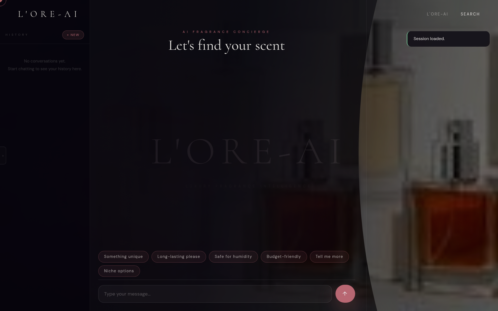

# L'ORE-AI

An AI fragrance concierge. Describe an occasion, a mood, or notes you like; it
answers with three picks from a fixed catalogue of 50 perfumes, each with a
reason, scores, and the notes that justify it.

Bun + Hono backend, MySQL/MariaDB, one static frontend (`index.html`) and an
admin panel (`/admin/`). No PHP: the admin UI is plain HTML/JS over the
TypeScript API, so phpMyAdmin is not needed.

<p align="center">
  
</p>

<p align="center"><em>Ask in Indonesian or English — the reply language follows the question.</em></p>

<p align="center">
  
</p>

<p align="center"><em>Three picks, each with popularity/niche scores, projection, and a reason drawn from the catalogue row.</em></p>

<p align="center">
  
</p>

<p align="center"><em>Admin panel: 50 perfumes, 10 brands, 26 scent families, with image upload.</em></p>

## How it works

```
POST /api/chat
  -> catalogue rows loaded from MySQL (src/types.ts)
  -> system prompt: reply in the user's language, pick TOP 3, JSON only
  -> provider chain: Kenari -> Groq -> Hugging Face
  -> JSON parsed, each recommendation id mapped back to its catalogue row
  -> unknown ids dropped; the client only ever sees real rows
```

The model can only *select* from the catalogue, never invent a perfume: the
response is joined against the database by id before it reaches the page.

## Stack

| Layer | Choice |
|---|---|
| Runtime | Bun 1.3+ |
| HTTP | Hono 4 |
| Database | MySQL / MariaDB (`mysql2`), utf8mb4 |
| Frontend | single-file HTML/CSS/JS, no build step |
| Media | committed to a GitHub repo, served via jsDelivr |
| LLM | Kenari (primary), Groq, Hugging Face (fallbacks) |

## Local development (XAMPP)

Prerequisites: Bun, and XAMPP at `/opt/lampp` with its MySQL/MariaDB.

```bash
cp .env.example .env          # DB_USER=root, DB_PASSWORD empty (XAMPP default)
./scripts/db.sh start         # sudo /opt/lampp/lampp startmysql + wait
./scripts/db.sh init          # schema.sql + seed.sql (50 perfumes)
bun install
bun run src/index.ts          # http://localhost:7860
```

`scripts/db.sh` also has `stop`, `status`, `reset` (drop + reload) and `cli`
(mysql shell). It probes the server with `mariadb-admin` because XAMPP's own
`lampp status` greps for `netstat`, which is not installed on this machine.

## Database

Everything needed to rebuild the database is in the repo:

| File | Contents |
|---|---|
| `schema.sql` | `lore_ai_db`, tables `perfumes`, `chat_sessions`, `chat_messages` |
| `seed.sql` | the 50-perfume catalogue, ids preserved |

```bash
./scripts/db.sh reset         # drop, recreate, reseed
./scripts/db.sh cli           # mysql> SELECT * FROM perfumes LIMIT 5;
```

| Table | Purpose |
|---|---|
| `perfumes` | catalogue: brand, name, image, family, occasion, mood, notes, longevity |
| `chat_sessions` | one row per conversation, `updated_at` bumped per message |
| `chat_messages` | messages, FK to `chat_sessions` with `ON DELETE CASCADE` |

`chat_messages.role` is `VARCHAR(16)`, not `ENUM`: the client posts arbitrary
role strings and a rejected value would abort the whole insert loop.

## API

| Method | Path | Notes |
|---|---|---|
| `POST` | `/api/chat` | `{messages, session_id}` → text + up to 3 recommendations |
| `POST` | `/api/chat/with-audio` | multipart, Whisper transcription |
| `POST` | `/api/chat/with-image` | multipart, vision model |
| `GET` | `/api/sessions` | last 50 sessions with message counts |
| `GET` | `/api/sessions/:id/messages` | transcript |
| `DELETE` | `/api/sessions/:id` | deletes messages via cascade |
| `POST` | `/api/shop-info` | Shopee/Tokopedia/Lazada/Maps links |
| `POST` | `/api/admin/login` | password → bearer token |
| `GET/POST/PUT/DELETE` | `/api/admin/perfumes[/:id]` | catalogue CRUD, multipart image |

Admin panel: http://localhost:7860/admin/ — password from `ADMIN_PASSWORD`
(default `group3jaya`; change it before exposing the app).

## Docker (alternative)

`docker compose up -d --build` runs the app plus its own MariaDB. The container
database is published on `127.0.0.1:3307` so it does not collide with XAMPP on
3306; inside the compose network the app uses `db:3306` with user `lore`.
