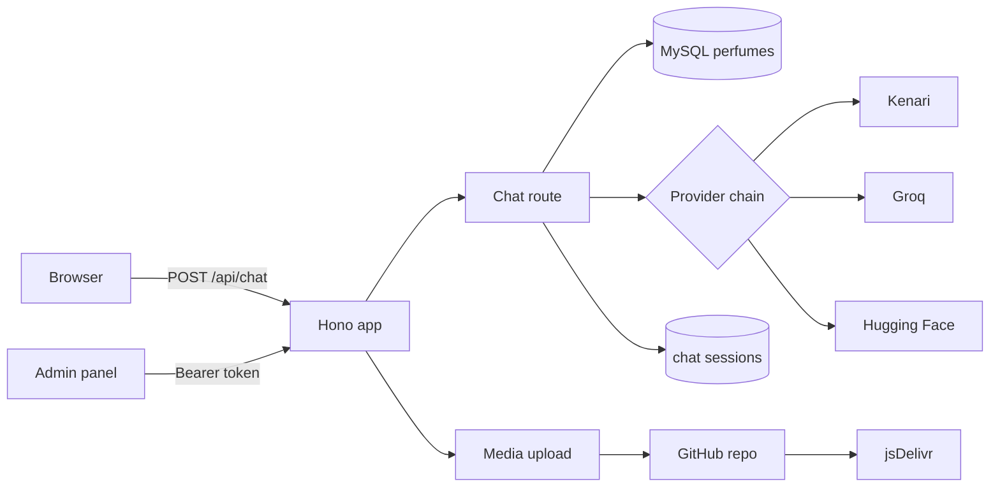

<h1 align="center">🧴 L'ORE-AI — AI Fragrance Concierge</h1>

<p align="center">
  
</p>

<p align="center">
  <em>"An AI fragrance concierge that cannot invent a perfume."</em><br>
  Bun + Hono · MySQL · 50-perfume catalogue · grounded recommendations
</p>

<p align="center">
  <a href="https://gesanghemas-lore-ai.hf.space"></a>
  <a href="https://github.com/Ellbaayy/Loreal"></a>
  <a href="#quick-start"></a>
  <a href="#configuration"></a>
</p>

<p align="center">
  <a href="#overview"></a>
  <a href="#features"></a>
  <a href="#screenshots"></a>
  <a href="#quick-start"></a>
  <a href="#database"></a>
  <a href="#api"></a>
  <a href="#configuration"></a>
  <a href="#deployment"></a>
</p>

---

## Overview

Describe an occasion, a mood, or notes you already like. L'ORE-AI answers with
three fragrances from a fixed catalogue of 50, each with a reason, popularity
and niche scores, projection, and the notes that justify the pick.

The interesting part is not the model call. It is what happens after it.

**The rule: the model proposes, the server verifies.**

```
POST /api/chat
  -> catalogue rows loaded from MySQL
  -> system prompt: reply in the user's language, pick TOP 3, JSON only
  -> provider chain: Kenari -> Groq -> Hugging Face
  -> JSON parsed, every recommendation id matched back to its catalogue row
  -> unknown ids dropped; the client only ever sees real rows
```

A recommender that hallucinates products is worse than no recommender. The model
is treated as an untrusted source: it can only *select* from the catalogue,
never *add* to it. The join happens by id in `src/routes/chat.ts`, so a reply
that names a perfume outside the database degrades to fewer cards, never to a
fabricated one.



## Features

- **Grounded recommendations** — every card is a database row, joined by id.
- **Bilingual by detection** — Indonesian or English, decided per message.
- **Provider chain** — Kenari (primary), Groq, Hugging Face; the first that
  answers wins, and a rejected `reasoning_effort` is retried without it.
- **Voice and vision input** — Whisper transcription, image-based queries.
- **Persistent sessions** — transcripts in MySQL, deletable with cascade.
- **Admin panel** — catalogue CRUD with image upload, no separate tooling.
- **Media on a CDN** — uploads are committed to a GitHub repo and served via
  jsDelivr, because `i.ibb.co` is DNS-sinkholed by some Indonesian ISPs.
- **No frontend build** — one `index.html`, served by the same process.

## Screenshots

<p align="center">
  
</p>

<p align="center"><em>Ask in Indonesian or English — the reply language follows the question.</em></p>

<p align="center">
  
</p>

<p align="center"><em>Three picks, each with popularity/niche scores, projection, and a reason drawn from the catalogue row.</em></p>

<p align="center">
  
</p>

<p align="center"><em>Admin panel: 50 perfumes, 10 brands, 26 scent families, with image upload.</em></p>

## Quick start

Prerequisites: [Bun](https://bun.sh) 1.3+ and XAMPP at `/opt/lampp` with its
MySQL/MariaDB.

```bash
git clone https://github.com/Ellbaayy/Loreal.git
cd Loreal

cp .env.example .env          # DB_USER=root, DB_PASSWORD empty (XAMPP default)
./scripts/db.sh start         # sudo /opt/lampp/lampp startmysql + wait
./scripts/db.sh init          # schema.sql + seed.sql (50 perfumes)

bun install
bun run src/index.ts          # http://localhost:7860
```

Open <http://localhost:7860> for the app and
<http://localhost:7860/admin/> for the panel (password from `ADMIN_PASSWORD`,
default `group3jaya` — change it before exposing the app).

`scripts/db.sh` also provides `stop`, `status`, `reset` (drop + reload) and
`cli` (mysql shell). It probes the server with `mariadb-admin` because XAMPP's
own `lampp status` greps for `netstat`, which is not installed on every distro.

Once the server is up, `./scripts/smoke.sh` checks the security invariants that
are easy to regress: no source or secret file served, client errors instead of
500s, admin auth rejecting the bare password, uploads rejecting non-images.

## Database

Everything needed to rebuild the database is in the repository.

| File | Contents |
|---|---|
| `schema.sql` | `lore_ai_db`, tables `perfumes`, `chat_sessions`, `chat_messages` |
| `seed.sql` | the 50-perfume catalogue, original ids preserved |

```bash
./scripts/db.sh reset         # drop, recreate, reseed
./scripts/db.sh cli           # mysql> SELECT * FROM perfumes LIMIT 5;
```

| Table | Purpose |
|---|---|
| `perfumes` | catalogue: brand, name, image, family, occasion, mood, notes, longevity |
| `chat_sessions` | one row per conversation, `updated_at` bumped per message, `visitor_id` scopes it to a browser |
| `chat_messages` | messages, FK to `chat_sessions` with `ON DELETE CASCADE` |

`chat_messages.role` is `VARCHAR(16)`, not `ENUM`: the client posts arbitrary
role strings, and a rejected value would abort the whole insert loop.

## API

| Method | Path | Notes |
|---|---|---|
| `POST` | `/api/chat` | `{messages, session_id}` → text + up to 3 recommendations |
| `POST` | `/api/chat/with-audio` | multipart, Whisper transcription |
| `POST` | `/api/chat/with-image` | multipart, vision model |
| `GET` | `/api/sessions` | last 50 sessions for this visitor |
| `GET` | `/api/sessions/:id/messages` | transcript, 404 unless the visitor owns it |
| `DELETE` | `/api/sessions/:id` | deletes messages via cascade |
| `POST` | `/api/shop-info` | Shopee / Tokopedia / Lazada / Maps links |
| `POST` | `/api/admin/login` | password → signed bearer token (12 h) |
| `GET` `POST` `PUT` `DELETE` | `/api/admin/perfumes[/:id]` | catalogue CRUD, multipart image |

## Security

The app is a public concierge with no user accounts, so the threat model is
"anyone on the internet can call every endpoint". What is enforced:

| Area | Control |
|---|---|
| Static files | Explicit allowlist (`/`, `/admin/`, `/uploads/*`). A catch-all `serveStatic` used to serve `.env`, `.git/config` and `src/` |
| XSS | Every value interpolated into `innerHTML` is escaped; URLs are restricted to `http(s)`; inline handler arguments are JSON-encoded |
| Admin auth | HMAC-signed token with a 12 h expiry, constant-time password compare, 5 attempts/min per IP. The password itself is never used as the token |
| Sessions | Scoped to an anonymous `x-visitor-id`; another visitor gets 404, not someone else's transcript |
| Request size | 256 KB for JSON, 12 MB for multipart, 5 MB per image, 10 MB per audio file |
| Rate limits | 20 chat calls/min, 30 shop lookups/min, 5 logins/min per IP |
| Uploads | Accepted only when the magic bytes are JPEG/PNG/WebP/GIF; the extension comes from the bytes, not the filename |
| Outbound links | Shop URLs must be `https` on Shopee/Tokopedia/Lazada/Google, otherwise the generated search links are used |
| Errors | Malformed JSON → 400, oversized body → 413, unknown route → 404; no stack traces in responses |
| Container | Runs as the unprivileged `bun` user |

Known limits, by design: there are no accounts, so a visitor id is a bearer
secret in `localStorage` — clearing it loses the history; rate limits live in
process memory, so they reset on restart and are per instance; and
`ADMIN_PASSWORD` must be set in production (the built-in default is logged as a
warning at startup).

## Configuration

All variables are read from the environment; `.env` is loaded by Bun.

| Variable | Default | Purpose |
|---|---|---|
| `APP_PORT` | `7860` | HTTP port |
| `DB_HOST` `DB_PORT` `DB_NAME` | `127.0.0.1` `3306` `lore_ai_db` | database target |
| `DB_USER` `DB_PASSWORD` | `root` / empty | XAMPP defaults |
| `DB_SSL` | `false` | TLS for managed MySQL |
| `ADMIN_PASSWORD` | `group3jaya` | admin password; also keys the signed tokens |
| `CORS_ORIGIN` | same-origin | comma-separated allowlist for cross-origin API use |
| `KENARI_API_KEY` | — | primary provider |
| `GROQ_API_KEY` | — | fallback chat + Whisper |
| `HF_TOKEN` | — | final fallback chat/vision |
| `GITHUB_MEDIA_TOKEN` | — | uploads; empty disables them |
| `MEDIA_REPO` `MEDIA_BRANCH` `MEDIA_CDN_BASE` | `Ellbaayy/lore-ai-media` `main` | media target |

## Project structure

```
.
├── src/
│   ├── index.ts          Hono app, CORS, static serving
│   ├── db.ts             mysql2 pool, query/execute helpers
│   ├── llm.ts            provider chain, vision, transcription
│   ├── storage.ts        GitHub + jsDelivr media upload
│   ├── types.ts          domain types, catalogue loader
│   └── routes/
│       ├── chat.ts       chat, audio, image, sessions
│       ├── shop.ts       marketplace links
│       └── admin.ts      login, catalogue CRUD
├── admin/index.html      admin panel
├── index.html            single-page frontend
├── schema.sql            database schema
├── seed.sql              50-perfume catalogue
├── scripts/db.sh         XAMPP start/stop/init/reset/cli
├── scripts/smoke.sh      smoke + security checks
├── docker-compose.yml    app + MariaDB (host port 3307)
└── docs/                 logo and screenshots
```

## Deployment

**Docker** — `docker compose up -d --build` runs the app plus its own MariaDB.
The container database is published on `127.0.0.1:3307` so it does not collide
with XAMPP on 3306; inside the compose network the app uses `db:3306` with user
`lore`.

**Hugging Face Space** — the same `Dockerfile` deploys unchanged. The Space's
own `README.md` carries the `sdk: docker` / `app_port: 7860` front matter; this
repository's README omits it so GitHub renders a clean page. Set the secrets
(`DB_*`, `KENARI_API_KEY`, `ADMIN_PASSWORD`, media variables) in the Space
settings, never in the repository.

---

<p align="center">
  <sub>Built with Bun, Hono and MySQL · <a href="#overview">back to top</a></sub>
</p>
